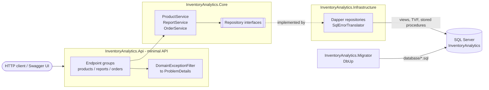

# Inventory & Order Analytics

A SQL Server project with a small .NET API on top. The database is the core: a normalized
inventory and order schema with constraints, covering indexes, views, a table-valued function and
stored procedures. The order procedure decrements stock safely when orders arrive at the same time,
and the analytics procedures use window functions and recursive CTEs. Schema changes are versioned
scripts applied by a **DbUp** migrator. An **ASP.NET Core 8 minimal API** calls the views and
procedures through **Dapper**, behind repository interfaces so the business logic can be tested
without a database. Failed orders return proper HTTP results: `409 Conflict` when stock runs out,
and `ProblemDetails` bodies for every error.

## Features

- **Normalized schema (3NF)**: Categories (hierarchical), Suppliers, Warehouses, Products,
  Inventory (stock per warehouse), Customers, Orders and OrderItems. Named PK, FK, UNIQUE and CHECK
  constraints, and a persisted computed `LineTotal` column.
- **Index design**: FK indexes, covering indexes (`INCLUDE`) and a filtered index. Each index has a
  comment naming the query it serves ([docs/queries.md](docs/queries.md)).
- **`usp_PlaceOrder`**: takes a table-valued parameter and runs one transaction with
  `XACT_ABORT ON`. The stock check and decrement happen in a single statement, so concurrent orders
  cannot oversell. Errors are raised with `THROW` (numbers 500xx), and anything that fails is
  rolled back.
- **Analytics**:
  - `usp_GetTopProducts` uses `RANK()`, `DENSE_RANK()`, `ROW_NUMBER()` and revenue share.
  - `usp_SalesByCategory` uses a recursive-CTE category roll-up and a running Pareto share.
  - `vw_MonthlySales` uses `LAG()` for month-over-month growth.
  - `vw_LowStock` lists reorder suggestions.
- **Inline table-valued function** `fn_GetProductStock`: stock for one product in every active
  warehouse.
- **Repeatable deployments**:
  - Journaled migrations run once.
  - `CREATE OR ALTER` programmability scripts are re-applied on every deploy.
  - The demo seed data is idempotent and deterministic.
- **REST API**: minimal API endpoint groups returning `TypedResults`. It provides:
  - OpenAPI/Swagger.
  - RFC 7807 `ProblemDetails` for 400, 404, 409 and 500.
  - Liveness and readiness health checks.
  - Fail-fast configuration validation at start-up.
- **Tests**: 57 unit tests and 26 SQL Server integration tests (xUnit).
  - Service tests use NSubstitute repository mocks.
  - Mapping tests cover SQL error numbers to domain exceptions.
  - In-memory API pipeline tests use `WebApplicationFactory`.
  - Integration tests deploy a fresh database with the real DbUp migrator and exercise the
    procedures, views, TVF and Dapper repositories against SQL Server 2022 in CI.

## Tech stack

| Area | Technology |
|---|---|
| Database | SQL Server 2022 / Azure SQL Database, T-SQL |
| Migrations | DbUp (`dbup-sqlserver`) console app |
| API | ASP.NET Core 8 minimal API, Dapper, Microsoft.Data.SqlClient, Swashbuckle |
| Tests | xUnit, NSubstitute, FluentAssertions 6, Microsoft.AspNetCore.Mvc.Testing |
| Tooling | Docker / Docker Compose, GitHub Actions |

## Architecture



Dependencies point inward. `Core` has no knowledge of SQL Server or HTTP: it defines the models,
repository interfaces, services and domain exceptions (`NotFoundException`,
`InsufficientStockException`, `RequestValidationException`). `Infrastructure` implements the
repositories with Dapper and translates the stored procedures' `THROW` numbers into those
exceptions. The API maps them to HTTP status codes in one place.

## Project structure

```
.
├── database/
│   ├── migrations/         # journaled once: tables, indexes, TVP type
│   ├── programmability/    # re-applied every deploy: views, TVF, stored procedures (CREATE OR ALTER)
│   ├── seed/               # idempotent demo data (applied with --seed)
│   └── tests/              # smoke-tests.sql: manual sqlcmd assertions
├── docs/queries.md         # query and index design notes
├── src/
│   ├── InventoryAnalytics.Core/            # models, repository interfaces, services, domain errors
│   ├── InventoryAnalytics.Infrastructure/  # Dapper repositories, connection factory, SQL error mapping
│   ├── InventoryAnalytics.Api/             # minimal API, ProblemDetails, health checks, Swagger
│   └── InventoryAnalytics.Migrator/        # DbUp console migrator
├── tests/
│   ├── InventoryAnalytics.UnitTests/         # services, mapping and in-memory API tests
│   └── InventoryAnalytics.IntegrationTests/  # real SQL Server: migrator, procedures, views, repositories
├── Dockerfile                              # multi-stage, targets: api, migrator
├── docker-compose.yml                      # sqlserver -> migrator (--seed) -> api
└── .github/workflows/ci.yml
```

## Running locally

### Option A: Docker Compose (everything)

```bash
docker compose up --build
```

1. **sqlserver** starts SQL Server 2022 and waits until `sqlcmd ... SELECT 1` succeeds.
2. **migrator** creates the `InventoryAnalytics` database, applies the scripts and seeds demo data
   (a year of 2025 orders).
3. **api** starts on <http://localhost:8080>. Swagger UI is at <http://localhost:8080/swagger>.

The compose file uses the example SA password `Your_strong_password123`. It is for local
development only.

### Option B: .NET SDK on the host, SQL Server in Docker

```bash
docker compose up -d sqlserver

export ConnectionStrings__InventoryDb="Server=localhost,1433;Database=InventoryAnalytics;User Id=sa;Password=Your_strong_password123;TrustServerCertificate=True"

dotnet run --project src/InventoryAnalytics.Migrator -- --seed
dotnet run --project src/InventoryAnalytics.Api        # http://localhost:5080/swagger
```

The migrator also accepts `--connection "<conn>"` and `--scripts <dir>`.

### Try it

```bash
# Top 5 products of 2025 (dates are inclusive, UTC)
curl "http://localhost:8080/api/reports/top-products?from=2025-01-01&to=2025-12-31&top=5"
```

IDs are `IDENTITY` values, so look them up by natural key instead of hard-coding them. The product
comes from the API (needs `jq`); the API has no customer or warehouse endpoints, so those come
from `sqlcmd` in the SQL Server container:

```bash
sql() {
  docker compose exec -T sqlserver /opt/mssql-tools18/bin/sqlcmd -C -S localhost -U sa \
    -P "Your_strong_password123" -d InventoryAnalytics -h -1 -W -Q "SET NOCOUNT ON; $1"
}
PRODUCT_ID=$(curl -s http://localhost:8080/api/products | jq '.[] | select(.sku == "AC-TRP-CF") | .productId')
CUSTOMER_ID=$(sql "SELECT CustomerId FROM dbo.Customers WHERE Email = 'ava.jansen@example.com';")
WAREHOUSE_ID=$(sql "SELECT WarehouseId FROM dbo.Warehouses WHERE Code = 'AMS01';")

# Place an order (201 Created + Location header)
curl -i -X POST http://localhost:8080/api/orders -H "Content-Type: application/json" \
     -d "{\"customerId\":$CUSTOMER_ID,\"warehouseId\":$WAREHOUSE_ID,\"lines\":[{\"productId\":$PRODUCT_ID,\"quantity\":2}]}"

# Order more than is in stock: 409 Conflict with a ProblemDetails body
curl -i -X POST http://localhost:8080/api/orders -H "Content-Type: application/json" \
     -d "{\"customerId\":$CUSTOMER_ID,\"warehouseId\":$WAREHOUSE_ID,\"lines\":[{\"productId\":$PRODUCT_ID,\"quantity\":999}]}"
```

### SQL smoke script (manual)

After seeding, [`database/tests/smoke-tests.sql`](database/tests/smoke-tests.sql) asserts
procedure, view and TVF behaviour and `THROW`s on any mismatch. sqlcmd defaults to
`QUOTED_IDENTIFIER OFF`, which breaks inserts into `dbo.Products` (it has a filtered index). Every
script now sets `ANSI_NULLS` and `QUOTED_IDENTIFIER` itself, and `-I` is kept as a second
safeguard.

```bash
docker compose exec -T sqlserver /opt/mssql-tools18/bin/sqlcmd -C -I -b -S localhost -U sa \
  -P "Your_strong_password123" -d InventoryAnalytics -i /dev/stdin < database/tests/smoke-tests.sql
```

## Running the tests

```bash
dotnet test
```

This runs both test projects. The unit tests need no database. The SQL Server integration tests
need a server and are **skipped** (not failed) when `SQLSERVER_TEST_CONNECTION` is not set.

### Unit tests (`tests/InventoryAnalytics.UnitTests`)

| Area | What is covered |
|---|---|
| `Services/*` | validation rules, default report periods (fixed `TimeProvider`), inclusive dates converted to the procedures' half-open ranges, not-found handling, `409` propagation |
| `Infrastructure/*` | every `THROW` number mapped to the right domain exception; unknown SQL errors are not swallowed; TVP `DataTable` shape |
| `Api/*` | the real pipeline with substituted repositories: `201` + `Location`, `409` for insufficient stock, `404`/`400` ProblemDetails, malformed input, and a `500` that does not leak exception details |

### SQL Server integration tests (`tests/InventoryAnalytics.IntegrationTests`)

A shared fixture creates a uniquely named database, deploys it with the real `DatabaseMigrator`
(the same DbUp code the console migrator runs) and the scripts in `/database`, and drops it at the
end. The tests create their own uniquely named rows and use their own reporting windows, so they do
not depend on `IDENTITY` values, the seed data or test order.

| Area | What is covered |
|---|---|
| `Database/MigrationTests` | every table, view, TVF, procedure and table type is created with `ANSI_NULLS`/`QUOTED_IDENTIFIER` ON; exact seed row counts; re-running the migrator and the seed script changes nothing |
| `Database/PlaceOrderProcedureTests` | stock decremented and order + merged items written; insufficient stock throws `50010`, leaves stock unchanged and writes nothing (rollback); `50001`–`50004` validation errors |
| `Database/AnalyticsProcedureTests` | `usp_GetTopProducts` ranking (`RANK` ties, `DENSE_RANK`, `ROW_NUMBER` per category, revenue share, half-open window, category filter, argument errors); `usp_SalesByCategory` root roll-up and Pareto shares |
| `Database/ViewAndFunctionTests` | `vw_LowStock`, `vw_MonthlySales` (`LAG` growth, cancelled orders excluded), `vw_ProductCatalog`, `fn_GetProductStock` |
| `Repositories/*` | the production Dapper repositories end to end, including TVP shape, result mapping and SQL error translation |

To run them locally against the Compose SQL Server:

```bash
docker compose up -d sqlserver
export SQLSERVER_TEST_CONNECTION="Server=localhost,1433;User Id=sa;Password=Your_strong_password123;TrustServerCertificate=True"
dotnet test tests/InventoryAnalytics.IntegrationTests
```

## Validation status

- **Run locally:** the solution builds with .NET 8 with no warnings. The 57 unit tests pass
  (`dotnet test`, 0 failed). The 26 integration tests are reported as skipped because no SQL Server
  is available on the development machine. I also ran the API against an unreachable database and
  checked its behaviour:
  - liveness returns 200 and readiness returns 503;
  - validation errors return 400 ProblemDetails;
  - start-up fails fast without a connection string.
- **Run in GitHub Actions:** the `sql-integration` job in [`ci.yml`](.github/workflows/ci.yml)
  starts a SQL Server 2022 service container, deploys the scripts with the DbUp migrator and runs
  the integration tests against it. The job fails if any of those tests is skipped. This is where
  the T-SQL is executed and checked.
- **Not run:** the Docker images and `docker-compose.yml` have not been built or run locally. CI
  builds the images but does not start the Compose stack.

## API endpoints

| Method | Route | Backed by | Success | Errors |
|---|---|---|---|---|
| GET | `/api/products?categoryId=&includeInactive=` | `vw_ProductCatalog` | 200 | 400 |
| GET | `/api/products/{productId}` | `vw_ProductCatalog` | 200 | 404 |
| GET | `/api/products/{productId}/stock` | `fn_GetProductStock` (inline TVF) | 200 | 404 |
| GET | `/api/reports/low-stock?warehouseId=` | `vw_LowStock` | 200 | 400 |
| GET | `/api/reports/monthly-sales?year=` | `vw_MonthlySales` | 200 | 400 |
| GET | `/api/reports/top-products?from=&to=&top=&categoryId=` | `usp_GetTopProducts` | 200 | 400 |
| GET | `/api/reports/sales-by-category?from=&to=&rollUp=` | `usp_SalesByCategory` | 200 | 400 |
| POST | `/api/orders` | `usp_PlaceOrder` | 201 | 400, 404, **409** |
| GET | `/api/orders/{orderId}` | `usp_GetOrderDetails` | 200 | 404 |
| GET | `/health/live` / `/health/ready` | process / `SELECT 1` | 200 | 503 |

On the report endpoints, `from` and `to` are optional inclusive dates (`yyyy-MM-dd`, UTC). They
default to the trailing 12 months, and the response echoes the resolved period. The seed data covers
calendar year 2025, so pass `from=2025-01-01&to=2025-12-31` to see it.

## Azure deployment notes

This setup has not been deployed. A deployment would look like this:

- **Database:** Azure SQL Database. Everything used here (TVPs, `CREATE OR ALTER`, window
  functions, `THROW`, filtered indexes) is supported. Run the migrator as a pipeline step or an
  **Azure Container Apps job** before rolling out a new API revision. Programmability scripts are
  idempotent, so re-running them is safe.
- **API hosting:** Azure Container Apps or App Service for Containers, using the `api` image target.
  Point the health probes at `/health/live` (liveness) and `/health/ready` (readiness).
- **Secrets and identity:** do not ship SQL passwords. Give the app a **managed identity**, add it
  as a contained database user, and use
  `Server=tcp:<server>.database.windows.net;Database=InventoryAnalytics;Authentication=Active Directory Default`
  (supported by Microsoft.Data.SqlClient 5). Anything else secret goes in **Key Vault**, referenced
  from app settings.
- **Configuration:** `ConnectionStrings__InventoryDb` and `Database__CommandTimeoutSeconds` are
  plain environment variables. Set `Swagger__Enabled=true` to expose Swagger outside Development.
- **Observability:** add Application Insights / OpenTelemetry. Errors are already logged with
  structured logging, and expected 4xx results are logged at Information level, not as errors.

## License

[MIT](LICENSE) © Prasad Ramineni
